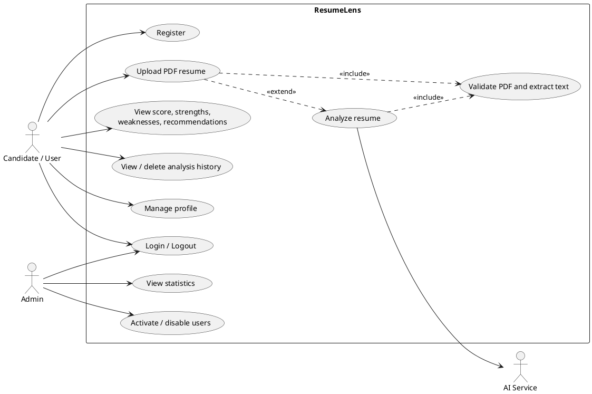
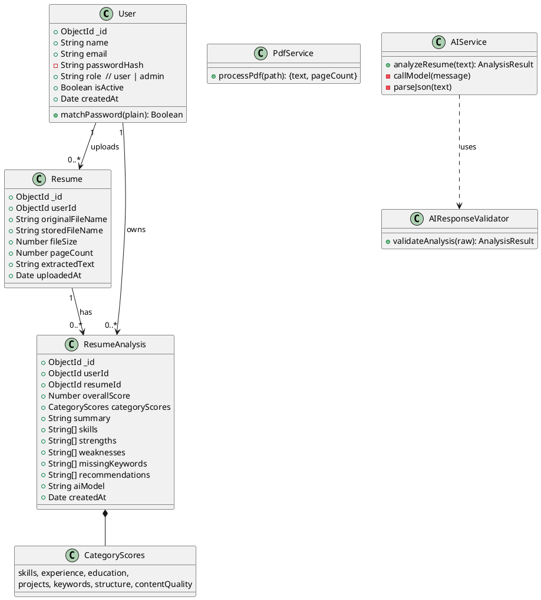
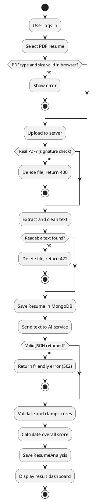
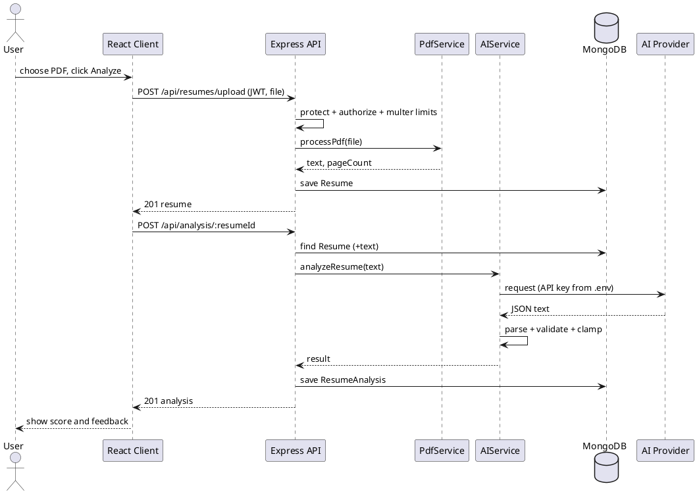
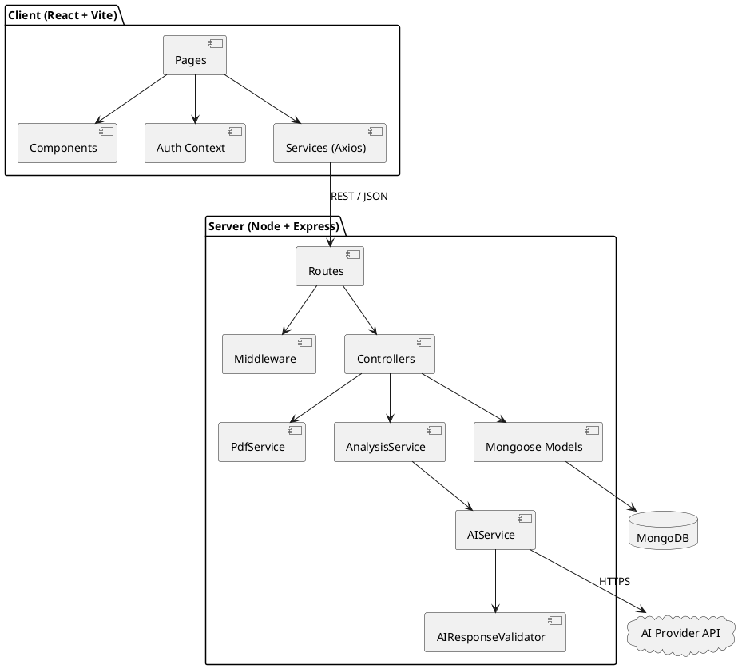
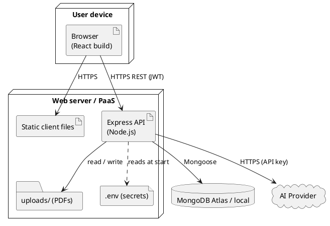

# UML Diagrams (PlantUML source)

Render any block at https://www.plantuml.com/plantuml, in VS Code (PlantUML extension), or import into draw.io (Arrange > Insert > Advanced > PlantUML). Export PNGs for your report.

## 1. Use case diagram

## 2. Class diagram

## 3. Activity diagram (resume analysis)

## 4. Sequence diagram

## 5. Component diagram

## 6. Deployment diagram

